# AWS-End-to-End-Automotive-Analytics-Pipeline

End-to-end AWS data pipeline using Amazon RDS (PostgreSQL), Amazon S3, Amazon Glue ETL, Amazon Athena, Amazon Step Functions, EventBridge, and Amazon SNS with a medallion architecture.


Tools used:
- AWS RDS (PostgreSQL)
- AWS S3
- AWS Glue ETL
- AWS Athena
- AWS Step Functions
- AWS EventBridge

The tools used maximize free tier usage; since Amazon Redshift cannot be used on the AWS free tier, a combination of AWS S3 as the file system and AWS Athena for querying is used.

Programming Language: Python, SQL
##
Step by step:

1. Checking source data in rds postgresql & csv in AWS S3:

    There are 3 raw tables in rds:
- after sales table:
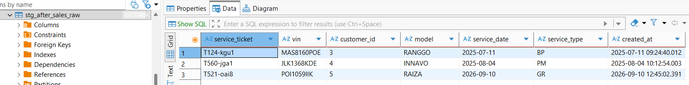
- customers table:
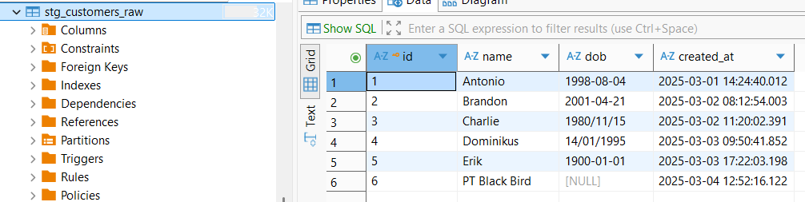
customers table need to be cleansed to have a standardized dob format
- sales table:
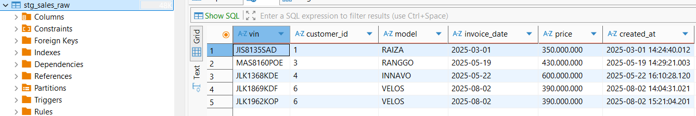
- customer address data in csv format in S3:
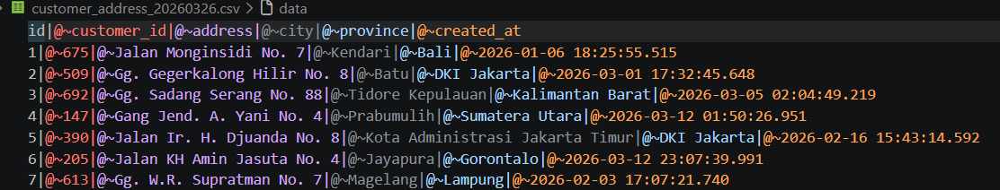
'|@~' is set as the delimiter, which will later be parsed by the AWS Glue Crawler using a Grok pattern to separate the columns.

##
2. Access Preparation (IAM Role & VPC)

- Create I AM role called `AWSGlueServiceRole`
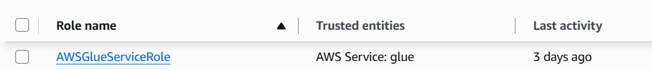
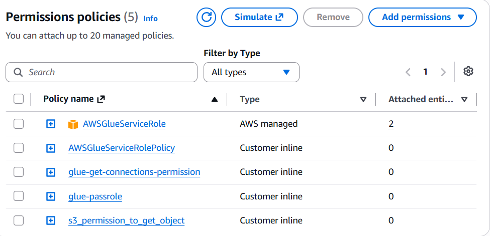
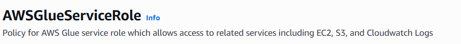
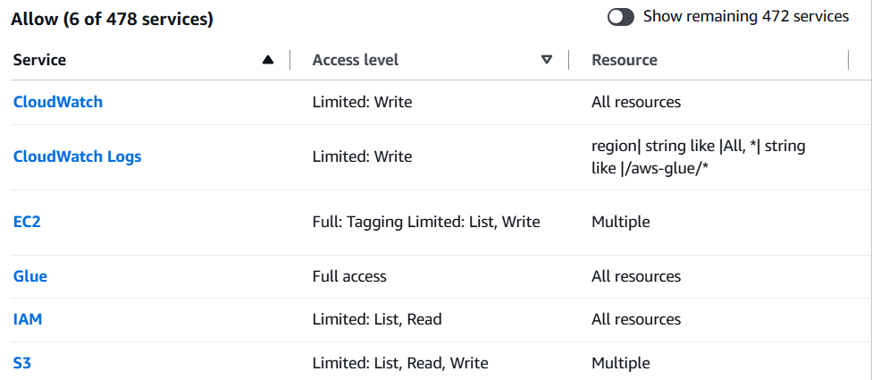
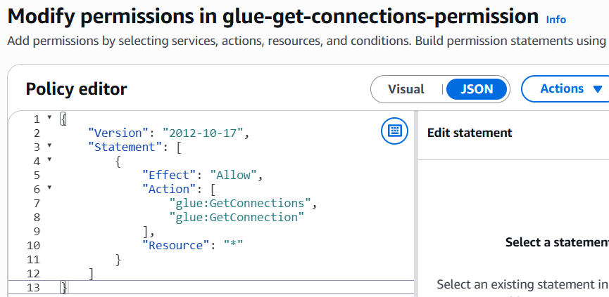
- glue-get-connections-permission:
{
	"Version": "2012-10-17",
	"Statement": [
		{
			"Effect": "Allow",
			"Action": [
				"glue:GetConnections",
				"glue:GetConnection"
			],
			"Resource": "*"
		}
	]
}
- glue-passrole:
{
	"Version": "2012-10-17",
	"Statement": [
		{
			"Effect": "Allow",
			"Action": "iam:PassRole",
			"Resource": "arn:aws:iam::<your-aws-id>:role/AWSGlueServiceRole",
			"Condition": {
				"StringLike": {
					"iam:PassedToService": "glue.amazonaws.com"
				}
			}
		}
	]
}

- s3-permission-to-get-object:
{
	"Version": "2012-10-17",
	"Statement": [
		{
			"Effect": "Allow",
			"Action": [
				"s3:GetObject",
				"s3:PutObject",
				"s3:DeleteObject",
				"s3:ListBucket"
			],
			"Resource": [
				"arn:aws:s3:::s3-datalake-dev",
				"arn:aws:s3:::s3-datalake-dev/*"
			]
		}
	]
}
##
3. Create VPC and Endpoint:

	Run in CloudShell

- STS Endpoint
aws ec2 create-vpc-endpoint \
    --vpc-id vpc-09c144870117796b3 \
    --service-name com.amazonaws.ap-southeast-2.sts \
    --vpc-endpoint-type Interface \
    --subnet-ids subnet-025a892b2dcf2ad88 subnet-0028ba81ac16dcb20 subnet-04a91d3e8bd12ba0f \
    --security-group-ids sg-0239f9b04392c8bc7 \
    --region ap-southeast-2

- Secrets Manager Endpoint
aws ec2 create-vpc-endpoint \
    --vpc-id vpc-09c144870117796b3 \
    --service-name com.amazonaws.ap-southeast-2.secretsmanager \
    --vpc-endpoint-type Interface \
    --subnet-ids subnet-025a892b2dcf2ad88 subnet-0028ba81ac16dcb20 subnet-04a91d3e8bd12ba0f \
    --security-group-ids sg-0239f9b04392c8bc7 \
    --region ap-southeast-2

- Glue Endpoint
aws ec2 create-vpc-endpoint \
    --vpc-id vpc-09c144870117796b3 \
    --service-name com.amazonaws.ap-southeast-2.glue \
    --vpc-endpoint-type Interface \
    --subnet-ids subnet-025a892b2dcf2ad88 subnet-0028ba81ac16dcb20 subnet-04a91d3e8bd12ba0f \
    --security-group-ids sg-0239f9b04392c8bc7 \
    --region ap-southeast-2

##
4. Create AWS Glue ETL Job:
- Add rds data connection:
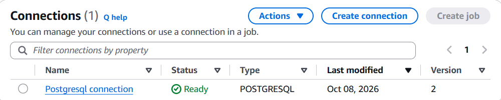

- Create crawlers & run:
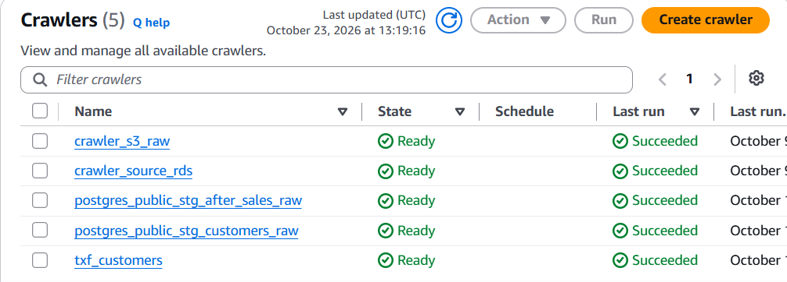

4.1. Create Glue Visual ETL Job:

	For every job use Glue 5.1, Language Python 3, Worker type G 1X (4vCPU and 16GB RAM), Number of workers: 2, and Job Timeout: 20 minutes

a. Silver layer job:
- ingest_txf_after_sales
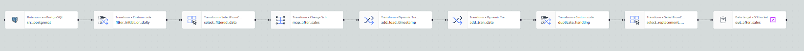
Extracts after-sales data from PostgreSQL for initial or daily loads, selects and maps fields, adds load timestamps and transaction dates, handles duplicates, and writes the processed data to Amazon S3 silver layer (table txf)
- ingest_txf_customers
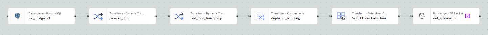
Extracts customer data from PostgreSQL, converts date-of-birth values, adds a load timestamp, handles duplicates, and writes the processed data to Amazon S3 silver layer table (table txf)
- ingest_txf_sales
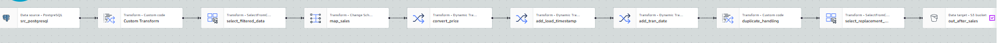
Extracts and filters sales data from PostgreSQL, maps fields, converts prices, adds load timestamps and transaction dates, handles duplicates, and writes the processed data to Amazon S3 silver layer table (table txf)

b. Gold layer job:

- ingest_mart_cust_service_prio
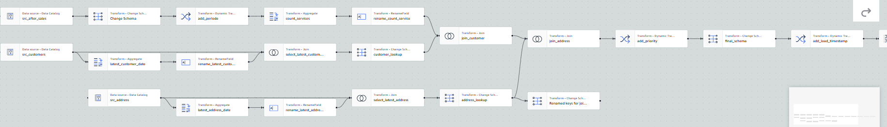
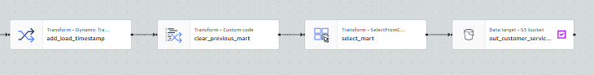
This AWS Glue job counts annual customer services, joins the latest customer and address records, assigns service priorities, adds a load timestamp, and replaces the previous customer service priority mart in Amazon S3.

- ingest_mart_sales
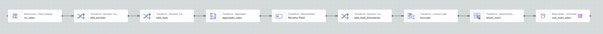
This AWS Glue job reads sales data from the Data Catalog, aggregates monthly sales by price class and vehicle model, adds a load timestamp, and replaces the previous sales mart in Amazon S3.


4.2. Create Glue ETL Notebook Job:

a. Bronze & silver layer job:
- ingest_stg-txf_customer_address

	For processing CSV files, use a Notebook Job to extract the file date.

<details>
<summary>Create Spark Session</summary>

```python
import sys
from awsglue.transforms import *
from awsglue.utils import getResolvedOptions
from pyspark.context import SparkContext
from awsglue.context import GlueContext
from awsglue.job import Job

sc = SparkContext.getOrCreate()
glueContext = GlueContext(sc)
spark = glueContext.spark_session
job = Job(glueContext)
```

</details>

<details>
<summary>Configure Parameters</summary>

```python
import sys
import boto3
from datetime import datetime, timezone, timedelta
from zoneinfo import ZoneInfo
from urllib.parse import urlsplit
from botocore.config import Config
from botocore.exceptions import ClientError
from awsglue.dynamicframe import DynamicFrame
from pyspark.sql import functions as F
from pyspark.sql.types import StructType, StructField, StringType, TimestampType

INPUT_DATE = None  # Otomatis H-1 WIB. Untuk manual, isi tanggal contohnya "2026-03-26".
DATE_PROCESS = None  # None = tanggal proses saat ini di WIB.
BASE_PATH = "s3://s3-datalake-dev/bronze-stg/customer_address_csv/"
OUTPUT_PATH = "s3://s3-datalake-dev/silver-txf/txf_customers_address/"
SOURCE_DATABASE = "bronze_stg"
SOURCE_TABLE = "customer_address_csv"
TARGET_DATABASE = "silver_txf"
TARGET_TABLE = "txf_customers_address"
COLUMNS = ["id", "customer_id", "address", "city", "province", "created_at"]

names = [name for name in ("JOB_NAME", "input_date", "date_process")
         if any(arg == f"--{name}" or arg.startswith(f"--{name}=") for arg in sys.argv)]
args = getResolvedOptions(sys.argv, names) if names else {}
INPUT_DATE = args.get("input_date", INPUT_DATE)
DATE_PROCESS = args.get("date_process", DATE_PROCESS)
job.init(args.get("JOB_NAME", "nb_ingest_stg_customer_address"), args)

spark.conf.set("spark.sql.session.timeZone", "Asia/Jakarta")
spark.conf.set("spark.sql.shuffle.partitions", "4")
spark.conf.set("spark.sql.caseSensitive", "true")
config = Config(retries={"mode": "standard", "total_max_attempts": 1},
                connect_timeout=5, read_timeout=10)
s3 = boto3.client("s3", config=config)
glue = boto3.client("glue", config=config)
```

</details>

<details>
<summary>Read CSV File</summary>

```python
table = glue.get_table(DatabaseName=SOURCE_DATABASE, Name=SOURCE_TABLE)["Table"]
descriptor = table["StorageDescriptor"]
if descriptor["Location"].rstrip("/") != BASE_PATH.rstrip("/"):
    raise ValueError("Location tabel source berbeda dari BASE_PATH; periksa konfigurasi")
columns = descriptor["Columns"]
if [c["Name"] for c in columns] != COLUMNS or any(c["Type"] != "string" for c in columns):
    raise ValueError("Schema source harus enam kolom string sesuai header CSV")

source_schema = StructType([StructField(c["Name"], StringType(), True) for c in columns])
source_df = (spark.read.schema(source_schema)
             .option("header", "true")
             .option("sep", "|@~")
             .option("enforceSchema", "false")
             .option("mode", "FAILFAST")
             .csv(file_path))
dyf = DynamicFrame.fromDF(source_df, glueContext, "src_customer_address")
dyf.printSchema()
```

</details>

<details>
<summary>Convert Types and Merge</summary>

```python
df = dyf.toDF()
converted = df.withColumn("_created_at", F.expr("try_cast(created_at AS timestamp)"))
invalid_timestamp = (F.col("created_at").isNotNull()
                     & (F.trim(F.col("created_at")) != "")
                     & F.col("_created_at").isNull())
if converted.filter(invalid_timestamp).limit(1).count():
    raise ValueError("Ada created_at yang tidak dapat dikonversi menjadi timestamp")

incoming = converted.select(
    F.col("id").cast("bigint").alias("id"),
    F.col("customer_id").cast("bigint").alias("customer_id"),
    F.col("address").cast("string").alias("address"),
    F.col("city").cast("string").alias("city"),
    F.col("province").cast("string").alias("province"),
    F.date_trunc(
        "millisecond", F.col("_created_at")
    ).alias("created_at"),
    F.lit(datetime.now(timezone.utc))
     .cast("timestamp")
     .alias("load_timestamp"),
).localCheckpoint(eager=True)

incoming_count = incoming.count()
if incoming_count == 0:
    raise ValueError("CSV tidak memiliki baris data")
assert_unique_customer(incoming, "CSV input")
uri = urlsplit(file_path)
if signature(s3.head_object(Bucket=uri.netloc, Key=uri.path.lstrip("/"))) != stable_signature:
    raise RuntimeError("Object CSV berubah selama pembacaan")

latest_date = find_latest_snapshot()
if latest_date and latest_date > date_process:
    raise ValueError("date_process tidak boleh lebih lama dari snapshot TXF terbaru")
if latest_date:
    previous = spark.read.parquet(f"{OUTPUT_PATH}date_process={latest_date}/").select(
        "id", "customer_id", "address", "city", "province", "created_at", "load_timestamp")
    previous = (
        previous
        .withColumn("id", F.col("id").cast("bigint"))
        .withColumn("customer_id", F.col("customer_id").cast("bigint"))
    )
    if previous.dtypes != incoming.dtypes:
        raise ValueError("Tipe data output lama berbeda; migrasikan terlebih dahulu")
    assert_unique_customer(previous, "TXF sebelumnya")
    merged = previous.alias("old").join(
        incoming.alias("new"), F.col("old.customer_id") == F.col("new.customer_id"), "full_outer")
    output_columns = [
        F.when(F.col("old.customer_id").isNotNull(), F.col("old.id"))
         .otherwise(F.col("new.id")).alias("id"),
        F.coalesce(F.col("old.customer_id"), F.col("new.customer_id")).alias("customer_id"),
    ]
    for name in ["address", "city", "province", "created_at", "load_timestamp"]:
        output_columns.append(
            F.when(F.col("new.customer_id").isNotNull(), F.col(f"new.{name}"))
             .otherwise(F.col(f"old.{name}")).alias(name))
    txf_df = merged.select(*output_columns)
else:
    txf_df = incoming

txf_df = txf_df.withColumn("date_process", F.lit(date_process).cast("date")).localCheckpoint(eager=True)
txf_count = txf_df.count()
DyF = DynamicFrame.fromDF(txf_df, glueContext, "txf_customer_address")
print(f"Input={incoming_count}; snapshot TXF={txf_count}; date_process={date_process}")
DyF.printSchema()
```
</details>

<details>
<summary>Write to Silver Layer</summary>

```python
# Preflight Catalog sebelum menghapus output partisi.
try:
    existing = glue.get_table(DatabaseName=TARGET_DATABASE, Name=TARGET_TABLE)["Table"]
except glue.exceptions.EntityNotFoundException:
    existing = None

if existing:
    if existing.get("Parameters", {}).get("table_type", "").upper() == "ICEBERG":
        raise ValueError("Target harus external table Parquet biasa, bukan Iceberg")
    if existing["StorageDescriptor"]["Location"].rstrip("/") != OUTPUT_PATH.rstrip("/"):
        raise ValueError("Location target Catalog berbeda dari OUTPUT_PATH")
    if [(p["Name"], p["Type"]) for p in existing.get("PartitionKeys", [])] != [("date_process", "date")]:
        raise ValueError("Target Catalog harus partition by date_process date")
    if existing.get("Parameters", {}).get("useGlueParquetWriter", "").lower() != "true":
        raise ValueError("Tambahkan table property useGlueParquetWriter=true di Catalog target dahulu")

try:
    glue.get_database(Name=TARGET_DATABASE)
except glue.exceptions.EntityNotFoundException:
    glue.create_database(DatabaseInput={"Name": TARGET_DATABASE})

# Hapus metadata partisi jika date_process yang sama sudah ada di Catalog.
if existing:
    spark.sql(
        f"ALTER TABLE `{TARGET_DATABASE}`.`{TARGET_TABLE}` "
        f"DROP IF EXISTS PARTITION (date_process='{validate_date(date_process)}')"
    )

partition_path = f"{OUTPUT_PATH.rstrip('/')}/date_process={validate_date(date_process)}/"
# Path dibentuk dari prefix silver tetap + tanggal tervalidasi; tidak pernah memakai BASE_PATH.
glueContext.purge_s3_path(partition_path, options={"retentionPeriod": 0})

s3output = glueContext.getSink(
    path=OUTPUT_PATH,
    connection_type="s3",
    updateBehavior="UPDATE_IN_DATABASE",
    partitionKeys=["date_process"],
    compression="snappy",
    enableUpdateCatalog=True,
    transformation_ctx="s3output",
)
s3output.setCatalogInfo(
    catalogDatabase=TARGET_DATABASE, catalogTableName=TARGET_TABLE
)
s3output.setFormat("glueparquet")
s3output.writeFrame(DyF)
job.commit()
print(f"SUCCESS: {incoming_count} input rows -> {txf_count} snapshot rows")
print(f"Catalog: {TARGET_DATABASE}.{TARGET_TABLE}; partition: {date_process}")
```

</details>

<details>
<summary>Stop Session</summary>

```
%stop_session
```

</details>


##
5. Create AWS Step Functions Workflow:
- Create AWS SNS topic called 
`data-pipeline-failure`
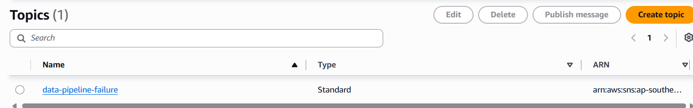
- Create state machines
- Create step functions for all of silver layer jobs in paralel (sf_ingest_silver) -> standard type
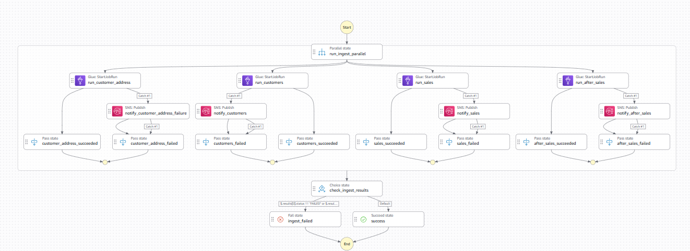
Each jobs run in paralel and if one of them failed will trigger email notifications using AWS SNS
- Create step functions for all of gold layer jobs in paralel (sf_ingest_gold_mart) -> standard type
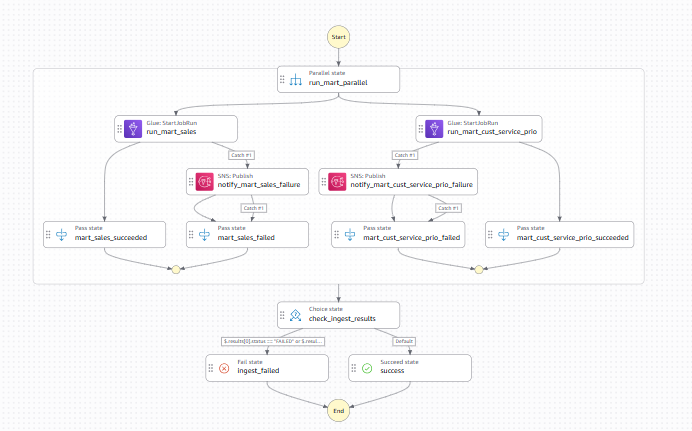
Each jobs run in paralel and if one of them failed will trigger email notifications using AWS SNS
##
6. Create AWS EventBridge:
- Create a scheduler named `daily-ingest-silver`

	Schedule sf_ingest_silver (step functions) to run everyday at 08.00 A.M. WIB
	
	Choose Recurring schedule → Cron-based schedule, cron(0 8 * * ? *), flexible time windows: Off

	Select target sf_ingest_silver

- Create a scheduler named `daily-gold`

	Schedule sf_ingest_gold_mart (step functions) to run everyday at 10.00 A.M. WIB

  	Choose Recurring schedule → Cron-based schedule, cron(0 10 * * ? *), flexible time windows: Off

	Select target sf_ingest_gold_mart

##
7. Check the table result in AWS Athena:

7.1. Bronze Layer
- customer address csv
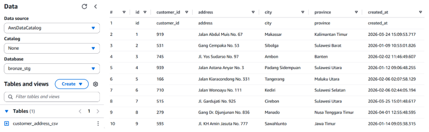

7.2. Silver Layer

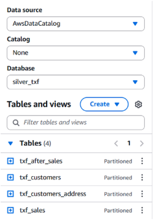
- txf after sales
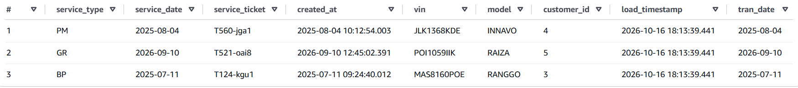
- txf sales
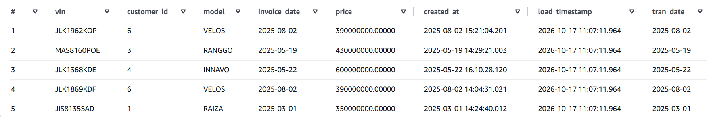
- txf customers
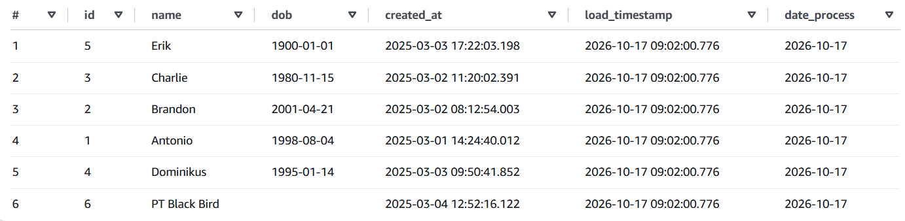
- txf customers_address
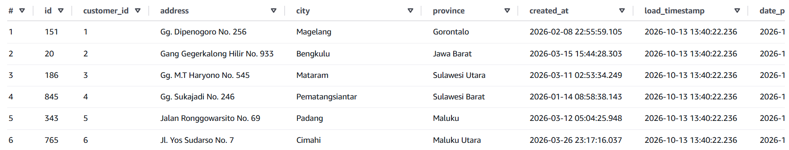

7.3. Gold Layer (Data Mart)

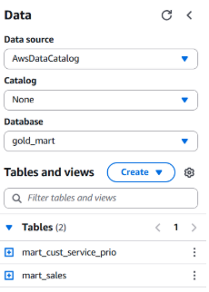
- mart customer service priority
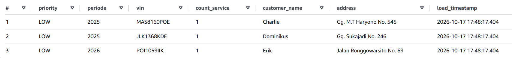
- mart sales
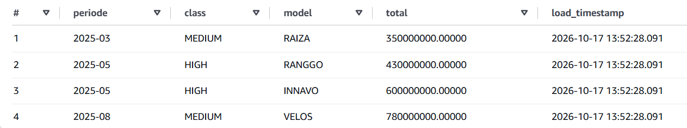


